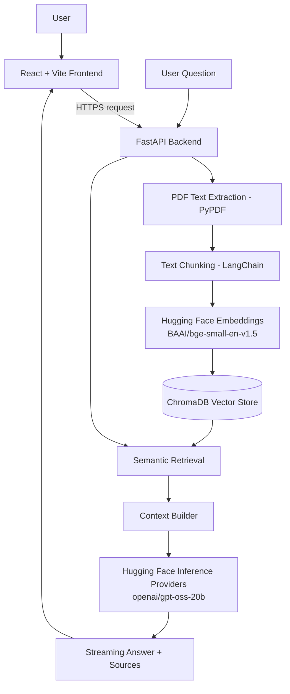

<div align="center">

# DocuMind AI

### Intelligent Conversations with Your Documents

**Upload a PDF. Ask a question. Get context-grounded answers with source references.**

A full-stack Retrieval-Augmented Generation (RAG) application built with React, FastAPI, LangChain, ChromaDB, and Hugging Face Inference Providers.

[Live Demo](YOUR_FRONTEND_URL) · [Backend API](YOUR_BACKEND_URL) · [API Docs](YOUR_BACKEND_URL/docs)

</div>

---

## Table of Contents

- [Overview](#overview)
- [Features](#features)
- [Live Demo](#live-demo)
- [How It Works](#how-it-works)
- [Architecture](#architecture)
- [Technology Stack](#technology-stack)
- [Project Configuration](#project-configuration)
- [Getting Started](#getting-started)
- [Environment Variables](#environment-variables)
- [API Documentation](#api-documentation)
- [Deployment](#deployment)
- [Limitations and Security Notes](#limitations-and-security-notes)
- [Future Improvements](#future-improvements)
- [Contributing](#contributing)
- [Author](#author)
- [Acknowledgements](#acknowledgements)

## Overview

DocuMind AI is a full-stack document question-answering application that lets users upload PDF files and ask questions about their contents in natural language.

It uses **Retrieval-Augmented Generation (RAG)** to retrieve relevant passages from an uploaded document and provide those passages as context to a language model before generating an answer. This helps ground responses in the supplied document rather than relying only on the model's pretrained knowledge.

Where available, answers include **document and page-level source references**, helping users trace responses back to the source material.

### Problem it addresses

Finding specific information in long PDF documents can be slow and frustrating. DocuMind AI provides a conversational interface for exploring document content without having to manually search every page.

### Project goals

- Make PDF content easier to query using natural language.
- Combine semantic search with language-model generation.
- Stream responses to provide a more responsive user experience.
- Return source information for retrieved passages.
- Demonstrate a deployable, full-stack AI application.

## Features

- **PDF upload** — submit documents through the web interface.
- **Semantic retrieval** — find passages relevant to a user's question.
- **RAG-based answers** — generate responses using retrieved document context.
- **Conversational interface** — ask questions in natural language.
- **Streaming responses** — receive generated text incrementally using Server-Sent Events (SSE).
- **Source attribution** — display document filenames and page references for retrieved content.
- **Session-based vector collections** — keep document embeddings organized by upload session.
- **Hosted AI inference** — use Hugging Face Inference Providers rather than requiring the generation model to run on the application server.
- **Full-stack architecture** — React and Vite frontend with a FastAPI backend.
- **Environment-based configuration** — keep API credentials outside source code.

## Live Demo

Replace the placeholders below with the deployed URLs before publishing this README.

| Resource | Link |
|---|---|
| Web application | [Open DocuMind AI](YOUR_FRONTEND_URL) |
| Backend API | [Open API](YOUR_BACKEND_URL) |
| Interactive API documentation | [Open Swagger UI](YOUR_BACKEND_URL/docs) |

> **Deployment note:** Ensure the frontend's API base URL points to the deployed backend, and configure the required environment variables in the hosting dashboard.

## How It Works

1. **Upload a PDF.** The user selects a document in the React interface.
2. **Extract text.** The FastAPI backend extracts text and page information using PyPDF.
3. **Split into chunks.** LangChain's `RecursiveCharacterTextSplitter` divides the text into overlapping segments.
4. **Generate embeddings.** The hosted `BAAI/bge-small-en-v1.5` embedding model converts text chunks into vectors.
5. **Store vectors.** Chunks, embeddings, and associated metadata are stored in ChromaDB in a collection associated with the document session.
6. **Retrieve relevant passages.** The user's question is embedded and compared with stored vectors to identify relevant chunks.
7. **Build context.** The retrieved passages are assembled into context for the language model.
8. **Generate an answer.** `openai/gpt-oss-20b` is called through Hugging Face Inference Providers with the question and retrieved context.
9. **Stream the response.** The backend streams generated text to the frontend using Server-Sent Events (SSE).
10. **Show sources.** Relevant document and page references are returned alongside the response where available.

## Architecture



## Technology Stack

| Layer | Technologies |
|---|---|
| Frontend | React, Vite, JavaScript, HTML, CSS, Fetch API |
| Backend | Python, FastAPI, Uvicorn |
| RAG framework | LangChain |
| PDF processing | PyPDF |
| Vector database | ChromaDB |
| Embeddings | `BAAI/bge-small-en-v1.5` |
| Language model | `openai/gpt-oss-20b` |
| Inference | Hugging Face Inference Providers |
| Response streaming | Server-Sent Events (SSE) |
| Deployment | GitHub, Render Static Site, Render Web Service |

## Project Configuration

### Text chunking

| Setting | Value |
|---|---:|
| Chunk size | 700 characters |
| Chunk overlap | 100 characters |

Overlapping chunks help preserve context across chunk boundaries. These settings can be adjusted based on document structure and retrieval quality.

### AI models

| Purpose | Model |
|---|---|
| Text embeddings | `BAAI/bge-small-en-v1.5` |
| Answer generation | `openai/gpt-oss-20b` |

The embedding and generation models are accessed through hosted inference services, so the application server does not need to load these models locally.

## Getting Started

Follow these steps to run the project locally. Adapt file paths and commands to match the actual repository structure.

### Prerequisites

- Python 3.10 or a version supported by the project's dependencies
- Node.js and npm
- A Hugging Face account and an access token with the permissions required by the selected inference providers
- Git

### 1. Clone the repository

```bash
git clone YOUR_GITHUB_REPOSITORY_URL
cd YOUR_REPOSITORY_DIRECTORY
```

Replace the placeholders with your repository URL and directory name.

### 2. Set up the backend

From the backend directory, create and activate a virtual environment.

**Windows (PowerShell)**

```powershell
python -m venv .venv
.\.venv\Scripts\Activate.ps1
```

**macOS / Linux**

```bash
python3 -m venv .venv
source .venv/bin/activate
```

Install the backend dependencies:

```bash
pip install -r requirements.txt
```

If the repository does not contain a `requirements.txt`, install the dependencies listed in the backend configuration and create a requirements file for reproducible setup.

Create a `.env` file in the backend directory and add the required configuration. See [Environment Variables](#environment-variables).

Start the API using the module path and application variable used in your project. For example, if the FastAPI instance is `app` in `main.py`:

```bash
uvicorn main:app --reload
```

The backend will usually be available at `http://127.0.0.1:8000`.

### 3. Set up the frontend

Open a second terminal and navigate to the frontend directory:

```bash
cd frontend
npm install
```

Configure the frontend API base URL to point to the local backend, using the environment variable name expected by the application. For Vite projects, client-side environment variables commonly use the `VITE_` prefix.

Start the development server:

```bash
npm run dev
```

Open the local URL printed by Vite in your terminal.

> **Note:** The commands above assume a conventional `frontend/` and backend layout. Update the paths and startup command if your repository uses a different structure.

## Environment Variables

Keep secrets in environment variables and hosting-provider settings. Do not commit API tokens or private credentials to GitHub.

Example backend `.env` template:

```dotenv
HF_TOKEN=your_hugging_face_token
```

Use the exact variable name expected by your code. If the application uses a different name, update this example accordingly.

For the frontend, configure the backend API base URL using the variable name your Vite application reads. For example:

```dotenv
VITE_API_BASE_URL=http://127.0.0.1:8000
```

Only use the example name above if it matches your frontend implementation. Restart the Vite server after changing environment variables.

Add `.env` and other secret-bearing files to `.gitignore`.

## API Documentation

When the FastAPI backend is running, open:

- Swagger UI: `http://127.0.0.1:8000/docs`
- ReDoc: `http://127.0.0.1:8000/redoc`

The available endpoints and request schemas shown in the interactive documentation are the source of truth for the API.

## Deployment

The application is designed for a split deployment:

- **Frontend:** Render Static Site
- **Backend:** Render Web Service
- **Model inference:** Hugging Face Inference Providers

Before deploying, check the following:

1. Push the latest code to GitHub.
2. Deploy the frontend and backend as separate Render services if that matches your setup.
3. Set the backend's Hugging Face token in the Render environment settings.
4. Configure the frontend to use the deployed backend URL.
5. Configure CORS to allow requests from the deployed frontend origin.
6. Confirm that the backend can reach the selected inference providers.
7. Test PDF upload, retrieval, streaming, and source references in the deployed application.
8. Update the live links at the top of this README.

## Limitations and Security Notes

- **Answers depend on document quality.** Scanned PDFs may require OCR if they do not contain extractable text.
- **RAG is not a guarantee of correctness.** Review important answers against the cited source pages.
- **Inference availability and cost may vary.** Hosted model access depends on provider availability, account limits, and current pricing.
- **Vector storage needs lifecycle management.** Confirm how session collections are isolated, expired, and deleted in your deployment.
- **Protect credentials.** Never expose Hugging Face tokens in frontend code, public logs, screenshots, or committed files.
- **Restrict production CORS.** Allow only the frontend origins that need access rather than using a wildcard where credentials or sensitive operations are involved.
- **Treat uploaded documents as sensitive.** Define retention and deletion policies appropriate to the data users submit.

## Future Improvements

Potential next steps include:

- Add persistent user accounts and document libraries.
- Support additional file types such as DOCX and TXT.
- Add OCR support for scanned PDFs.
- Improve retrieval with reranking and configurable top-k results.
- Display source excerpts and clickable page references.
- Add automated tests for upload, retrieval, streaming, and error handling.
- Add rate limiting, upload-size limits, and clearer error messages.
- Add document deletion and automatic cleanup of expired session collections.
- Add evaluation datasets to measure retrieval relevance and answer faithfulness.
- Improve observability with structured logs and latency metrics.

## Contributing

Contributions, bug reports, and suggestions are welcome.

1. Fork the repository.
2. Create a branch for your change.
3. Make and test your changes.
4. Open a pull request with a clear description of the improvement.

If you discover a bug, include steps to reproduce it and relevant error messages, while removing secrets and private document content.

## Author

**Your Name**

- GitHub: [Your GitHub Profile](YOUR_GITHUB_PROFILE_URL)
- Portfolio: [Your Portfolio](YOUR_PORTFOLIO_URL)
- LinkedIn: [Your LinkedIn Profile](YOUR_LINKEDIN_URL)

Replace the placeholders with your public profile links before publishing.

## Acknowledgements

DocuMind AI builds on the work of the open-source and developer communities behind:

- [Hugging Face](https://huggingface.co/)
- [LangChain](https://www.langchain.com/)
- [FastAPI](https://fastapi.tiangolo.com/)
- [ChromaDB](https://www.trychroma.com/)
- [React](https://react.dev/)
- [Vite](https://vite.dev/)

---

<div align="center">

**DocuMind AI — Make your documents easier to understand.**

</div>
